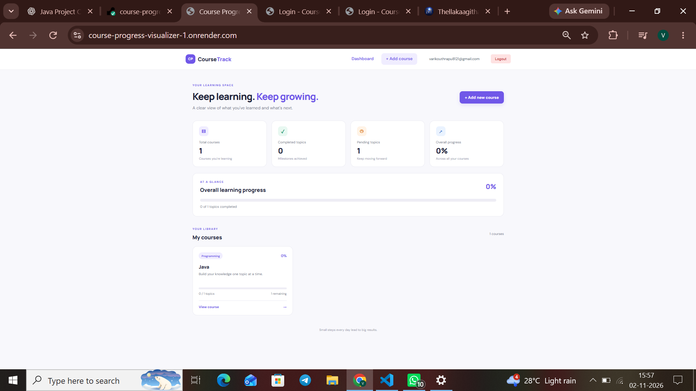
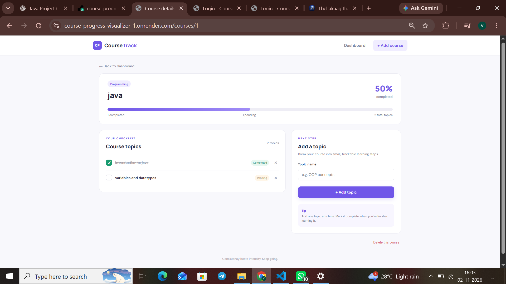

# Course Progress Visualizer

A beginner-friendly Java Full Stack web application that helps users organize courses, manage topics, and track their learning progress through a visual dashboard.

## 🚀 Live Demo

[View Live Application](https://course-progress-visualizer-1.onrender.com)

## ✨ Features

- Dashboard displaying total courses and learning progress.
- Create and delete courses.
- Add topics under each course.
- Mark topics as completed or pending.
- Visual progress bars and completion percentages.
- H2 file-based database for persistent local storage.

## 🛠️ Technologies Used

- Java 21
- Spring Boot
- Spring MVC
- Spring Data JPA
- Thymeleaf
- HTML5
- CSS3
- H2 Database
- Maven
- Git & GitHub
- Render

## 📸 Screenshots

### Dashboard


### Course Management


### Topic Progress


## 💻 Requirements

- JDK 21 or later
- Maven 3.6+

## ▶️ Run Locally

1. Clone the repository:

   `git clone YOUR_GITHUB_REPOSITORY_URL`

2. Open the project folder in VS Code.

3. Run the application:

   `mvn spring-boot:run`

4. Open your browser:

   `http://localhost:8080`

## 🗄️ H2 Database Console

- URL: `http://localhost:8080/h2-console`
- JDBC URL: `jdbc:h2:file:./data/courseprogress`
- Username: `sa`
- Password: Leave empty

## 📂 Project Structure

```text
src/main/java/com/varshini/courseprogress/
  controller/
  model/
  repository/
  service/

src/main/resources/
  templates/
  static/css/
```

## 👩‍💻 Author

**Kanaka Varshini Kouthrapu**

## 📝 Note

This project was developed as a learning and portfolio project.